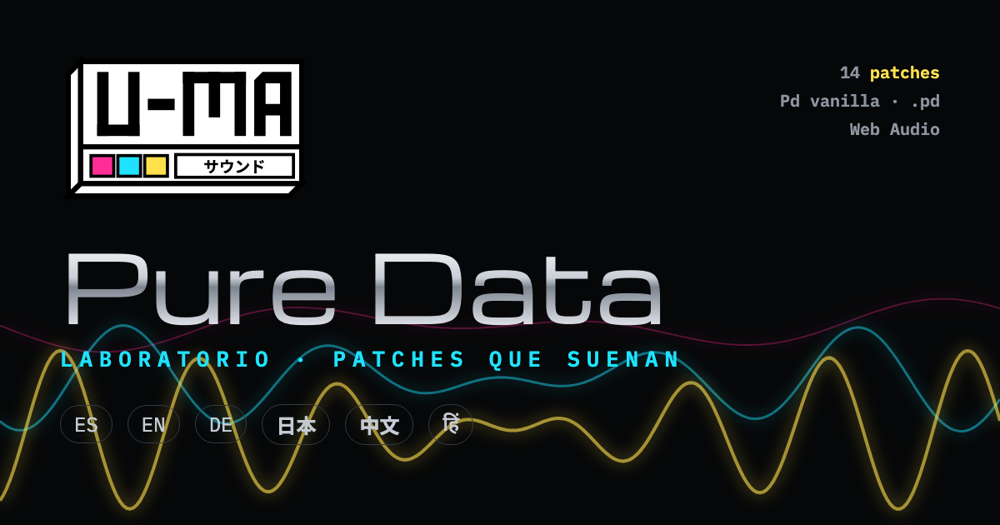

# Laboratorio Pd · U-MA

Un curso para entender cómo piensa **Pure Data**: mensajes, señal, orden de ejecución, síntesis, envolventes, secuencias, delays y tablas. Cada ejemplo es un **patch vivo**: tocás las cajas, ves viajar los mensajes por los cables y lo escuchás en el navegador. No hace falta instalar nada, y cada patch se puede bajar como `.pd` vanilla para abrirlo en Pd.

**▶ Abrir la app:** https://buenosairesfront.github.io/puredata/

Parte de [Buenos Aires Front](https://www.instagram.com/buenos.aires.front/) · herramientas U-MA.

**Idiomas:** ES · EN · DE · 日本 · 中文 · हिं



---

## Qué tiene

- **14 lecciones en 3 partes**
  1. *La lógica del lenguaje*: cómo se lee un patch, mensajes, inlet caliente y frío, orden de derecha a izquierda.
  2. *Señal y síntesis*: señal de audio, aditiva, ring/AM, FM, filtros (sustractiva).
  3. *Tiempo, secuencias y memoria*: envolventes con `vline~`, secuenciador, azar con reglas, delay con feedback, wavetables.
- **Cada lección**: explicación, un patch que suena, “Probá esto”, un consejo y los objetos usados (enlazados a la caja de objetos).
- **Patch vivo**: los mensajes se ven viajando (amarillo), la señal fluye por los cables gruesos (cian) y todo lo magenta se toca, arrastra o dibuja (números, sliders, toggles, tablas).
- **Osciloscopio** con tres vistas (onda, espectro, envolvente) y **ventana de Pd** con lo que imprimen los `print`.
- **Exportar a .pd**: cada patch se ve como texto, se copia o se descarga, listo para abrir en Pd vanilla. Las versiones en castellano también están en [`patches/`](patches/).
- **Reglas de oro** de la lógica de Pd, **caja de objetos** (45, con buscador y filtros) y **atajos de teclado**.

## Idiomas

La app arranca en castellano. El idioma se cambia con los botones de arriba a la derecha o con la URL, y queda recordado en ese navegador:

| Idioma | Sigla | Enlace |
|---|---|---|
| Español | ES | [`?lang=es`](https://buenosairesfront.github.io/puredata/?lang=es) |
| English | EN | [`?lang=en`](https://buenosairesfront.github.io/puredata/?lang=en) |
| Deutsch | DE | [`?lang=de`](https://buenosairesfront.github.io/puredata/?lang=de) |
| 日本語 | 日本 | [`?lang=ja`](https://buenosairesfront.github.io/puredata/?lang=ja) |
| 中文 | 中文 | [`?lang=zh`](https://buenosairesfront.github.io/puredata/?lang=zh) |
| हिन्दी | हिं | [`?lang=hi`](https://buenosairesfront.github.io/puredata/?lang=hi) |

Se puede ir directo a una lección con `#id`, por ejemplo [`?lang=en#fm`](https://buenosairesfront.github.io/puredata/?lang=en#fm). Lista de ids en [`docs/GUIA.md`](docs/GUIA.md).

Cómo sumar un idioma: [`docs/IDIOMAS.md`](docs/IDIOMAS.md).

## Cómo funciona

No son audios grabados: es un **Pd en miniatura** escrito en JavaScript, sin dependencias.

| Pieza | Archivo | Qué hace |
|---|---|---|
| Arranque e idiomas | `js/i18n.js` | Elige el idioma, carga `lang/es.js` + el idioma pedido y después el motor. |
| Motor | `js/engine.js` | Dibuja el patch en SVG, interpreta los mensajes de control (orden derecha→izquierda, inlets fríos y calientes, `$1`, `;` por nombre) y arma el grafo de señal con Web Audio. Exporta a `.pd`. |
| Lecciones | `js/app.js` | Estructura y patches de las 14 lecciones, caja de objetos y armado de la página. |
| Textos | `lang/<idioma>.js` | Todos los textos de la interfaz, las lecciones, la caja de objetos y las etiquetas dentro de los patches. |
| Estilos | `css/style.css` | Estética U-MA oscura: magenta, cian y amarillo. |

Detalles en [`docs/ARQUITECTURA.md`](docs/ARQUITECTURA.md).

## Correr en local

Cualquier servidor estático sirve (los idiomas se cargan con `<script>`, así que hace falta `http://`, no `file://`):

```bash
python3 -m http.server 8000
```

y abrir http://localhost:8000/

## Documentación

- [`docs/GUIA.md`](docs/GUIA.md): recorrido por la app, lecciones e ids.
- [`docs/ARQUITECTURA.md`](docs/ARQUITECTURA.md): cómo está hecho el mini-Pd y qué objetos entiende.
- [`docs/IDIOMAS.md`](docs/IDIOMAS.md): idiomas, `?lang=` y cómo sumar uno.
- [`docs/PUBLICAR.md`](docs/PUBLICAR.md): GitHub Pages y enlace desde la landing de Buenos Aires Front / Instagram.
- [`CHANGELOG.md`](CHANGELOG.md): historial.

## Aviso

Proyecto educativo independiente, sin afiliación con el proyecto Pure Data. Las explicaciones, los patches y el motor de audio son originales. Pd vanilla es de Miller Puckette: https://msp.ucsd.edu/software.html · comunidad: https://puredata.info

---

**English:** An interactive Pure Data course with 14 live patches that play in the browser (messages, hot/cold inlets, execution order, signal, additive, ring/AM, FM, filters, envelopes, sequencer, generative, delay, wavetables), an object cheat sheet and `.pd` export. Available in Spanish, English, German, Japanese, Chinese and Hindi: add `?lang=en` (or `de`, `ja`, `zh`, `hi`) to the URL.
